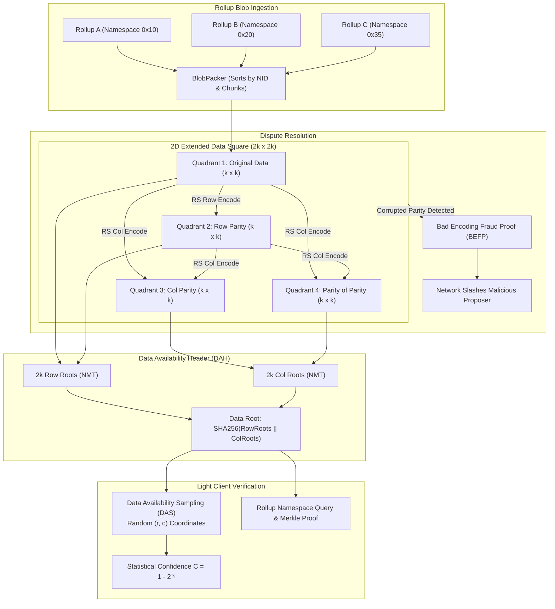

# AstraeaGrid

[](https://github.com/ZengLLQ/astraea-grid/actions/workflows/ci.yml)
[](LICENSE)
[](https://goreportcard.com/report/github.com/ZengLLQ/astraea-grid)
[](https://golang.org/)

**AstraeaGrid** is a high-performance, modular Data Availability (DA) and light client verification engine written in Go. It implements **2-Dimensional Reed-Solomon Erasure Coding**, **Namespaced Merkle Trees (NMT)**, **Data Availability Sampling (DAS)**, and **Bad Encoding Fraud Proofs (BEFP)** for trustless Layer-2 rollups and sovereign chains.

---

## Architecture Overview



---

## Cryptographic & Mathematical Principles

### 1. Finite Field Arithmetic over $GF(2^8)$
Erasure coding operates over Galois Field $GF(2^8)$ defined by the irreducible polynomial:

$$p(x) = x^8 + x^4 + x^3 + x^2 + 1 \quad (0x11D)$$

Addition and subtraction are bitwise XOR ($\oplus$). Multiplication uses precomputed logarithm and exponential tables for $O(1)$ operations:

$$a \cdot b = \exp\left( (\log(a) + \log(b)) \pmod{255} \right)$$

### 2. Systematic 2D Reed-Solomon Coding
A $k \times k$ matrix of original data shares is extended to a $2k \times 2k$ Extended Data Square (EDS) using a systematic Cauchy generator matrix:

$$P_{i, j} = \frac{1}{x_i \oplus y_j}$$

where $\{x_i\}$ and $\{y_j\}$ are disjoint subsets of $GF(2^8)$. Any $k \times k$ submatrix of a Cauchy matrix is guaranteed to be non-singular, ensuring that **any $k$ out of $2k$ shares** along any row or column can reconstruct the full vector.

### 3. Namespaced Merkle Trees (NMT)
Leaves contain an 8-byte `NamespaceID` and payload data. Nodes maintain the minimum and maximum namespaces of their subtrees:

$$\text{Leaf Hash} = \text{SHA256}(0x00 \,||\, \text{NamespaceID} \,||\, \text{Data})$$

$$\text{Node Hash} = \text{SHA256}(0x01 \,||\, \min(\text{NID}_L, \text{NID}_R) \,||\, \max(\text{NID}_L, \text{NID}_R) \,||\, H_L \,||\, H_R)$$

* **Inclusion Proofs**: Prove that all shares belonging to Rollup $k$ are included in the tree.
* **Absence Proofs**: Prove that no shares for Rollup $k$ exist by providing a border range where $N_{i-1} < k < N_i$.

### 4. Data Availability Sampling (DAS)
Light nodes randomly sample share coordinates $(r, c)$ in the $2k \times 2k$ square and verify their Merkle inclusion proofs against the trusted Data Availability Header (DAH).

If an attacker withholds data such that the block cannot be reconstructed, they must withhold at least $50\%$ of the shares in at least $k+1$ rows or columns. The probability of an attacker escaping detection after $s$ independent random samples is:

$$P(\text{undetected}) \le \left(\frac{1}{2}\right)^s$$

$$\text{Confidence} = 1 - 2^{-s}$$

| Number of Samples ($s$) | Probability of Undetected Withholding | Light Client Confidence |
| :---: | :---: | :---: |
| 10 | $9.77 \times 10^{-4}$ | **99.9023%** |
| 20 | $9.54 \times 10^{-7}$ | **99.9999%** |
| 30 | $9.31 \times 10^{-10}$ | **99.9999999%** |

### 5. Bad Encoding Fraud Proofs (BEFP)
If a block producer publishes a DAH committing to an invalid Reed-Solomon row or column, any full node can generate a Bad Encoding Fraud Proof (BEFP) containing:
1. Merkle inclusion proofs for $k$ verified data shares in that row/column.
2. The claimed corrupted parity share with its Merkle inclusion proof.

Any light client can locally re-encode the $k$ data shares in $O(k)$ time, observe the parity mismatch, and immediately reject the fraudulent block.

---

## Directory Structure

```
pkg/
├── rs/         # Galois Field GF(2^8) arithmetic, Cauchy generator, Reed-Solomon codec
├── nmt/        # Namespaced Merkle Tree, leaf/node hashing, inclusion & absence proofs
├── eds/        # 2D Extended Data Square (EDS) and Data Availability Header (DAH)
├── das/        # Data Availability Sampling (DAS) protocol and statistical confidence
├── fraud/      # Bad Encoding Fraud Proofs (BEFP) generation & verification
├── mempool/    # Rollup blob ingestion, sorting, and k x k packing
└── node/       # FullNode and LightNode simulation engine
cmd/
└── astraea/    # CLI entrypoint for produce, sample, and fraud-demo commands
```

---

## Installation & CLI Usage

### Build from Source
```bash
git clone https://github.com/ZengLLQ/astraea-grid.git
cd astraea-grid
go build -o bin/astraea ./cmd/astraea
```

### Run Demos

#### 1. Produce a DA Block with Rollup Blobs
```bash
./bin/astraea produce
```
Packs transactions from multiple sovereign rollups, generates the $2k \times 2k$ 2D Reed-Solomon matrix, and computes the Data Availability Header (DAH).

#### 2. Run Light Client Data Availability Sampling
```bash
./bin/astraea sample
```
Simulates a light node sampling random coordinates across the 2D EDS, verifying Merkle proofs and outputting statistical availability confidence.

#### 3. Demonstrate Bad Encoding Fraud Proof (BEFP)
```bash
./bin/astraea fraud-demo
```
Simulates a malicious block producer committing a corrupted parity share, followed by a full node generating a BEFP that light clients use to reject the block.

---

## Benchmarks

Benchmark executed on AMD Ryzen 5 5600 6-Core Processor:

```bash
go test -bench BenchmarkRSEncode16x16 -run none ./pkg/rs
```

```
BenchmarkRSEncode16x16-12    6321    185690 ns/op (0.18 ms per 16x16 RS matrix)
```

---

## Multi-Platform CI Matrix

Continuous integration runs automatically on every commit across 6 platform/version combinations:
* **Operating Systems**: Ubuntu Linux (`ubuntu-latest`), macOS (`macos-latest`), Windows (`windows-latest`)
* **Go Versions**: Go `1.22`, Go `1.23`

## License

This project is licensed under the [MIT License](LICENSE).
